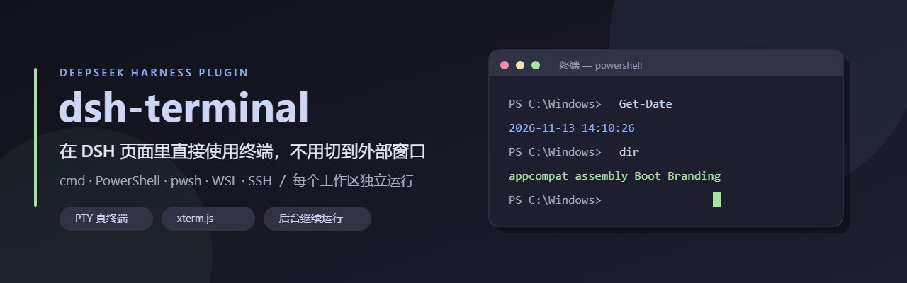
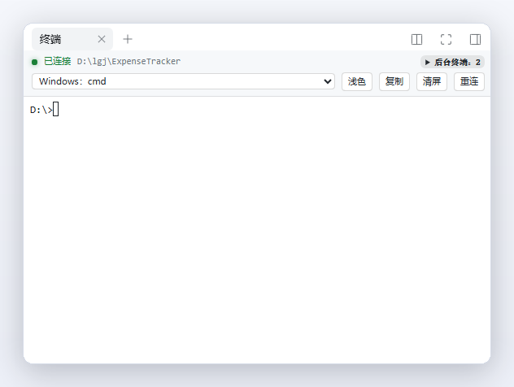

# dsh-terminal

<p align="center"></p>

在 **DSH（DeepSeek Harness）** 页面里直接使用终端，不用切换到外部窗口。

默认接入 **DSH 官方右侧栏**，无需安装 dsh-better-sidebar。

> 第三方插件，非 DeepSeek 官方出品。

[](https://www.npmjs.com/package/@lylgj/dsh-terminal)
[](LICENSE)

npm 包名 `@lylgj/dsh-terminal`，源码在 [Lylgj/dsh-terminal](https://github.com/Lylgj/dsh-terminal)。

## 功能

- **自动识别环境**：Windows 本地使用 cmd，WSL 工作区使用对应发行版的 bash，远程工作区连接 SSH，macOS/Linux 使用登录 shell。
- **手动切换终端**：支持 cmd、PowerShell、pwsh、WSL 和 SSH，选择按工作区记住。
- **工作区独立运行**：切换会话或收起侧栏时，原终端继续在后台运行；同一工作区复用终端。
- **复制与粘贴**：可设置 Ctrl+C 复制、选中即复制、右键粘贴。
- **常用操作**：浅色/暗色主题、清屏、重连、后台终端管理。
- **每个环境最多 10 个终端**：本机、各 WSL 发行版、各 SSH 主机分别计数。

官方侧栏不可用时，自动兼容 dsh-better-sidebar 页签；两者都没有时使用独立面板。

## 界面

<p></p>

右侧栏的「终端」页签：左上显示已连接的工作区，中间下拉切换 shell（这里是 `Windows: cmd`），右侧是浅色 / 复制 / 清屏 / 重连，「后台终端」是当前环境里还开着的终端数量。

## 安装

需要 DSH **0.2.2-rc.1 或更新版本**、Node.js **20 或更新版本**，并能够访问 GitHub。

插件的 npm 包名是 `@lylgj/dsh-terminal`；下面两种装法都是让 DSH 从 npm 源拉取它。装插件要走 DSH 自己的流程（界面或 `dsh plugin`），直接 `npm install` 不会被识别成插件。

**在界面里装（推荐）**

左侧栏 →「插件」→「添加插件」，在「包名或地址」里填：

```
@lylgj/dsh-terminal
```

点「安装」，装完重启 DSH。插件带原生依赖 `node-pty`，DSH 会问是否允许运行构建脚本，选**允许**即可——它只是把预编译好的二进制放到位，不需要本机装编译器。

**用命令行装**

先退出 DSH，在 profile 的 `pnpm-workspace.yaml` 里加上下面这段（`node-pty` 需要构建脚本，否则 pnpm 会拦下并报 `ERR_PNPM_IGNORED_BUILDS`）：

```yaml
allowBuilds:
  node-pty: true
```

再运行：

```bash
dsh plugin --profile desktop add @lylgj/dsh-terminal
```

如果 npm 源不通，也可以直接从仓库装（内容相同，但插件页不会显示版本更新）：

```bash
dsh plugin --profile desktop add github:Lylgj/dsh-terminal
```

使用 `dsh web` 时，将 `desktop` 改为对应的 profile 名称（默认 `web`）。安装完成后重新打开 DSH，无需手动修改配置。

**从源码装（自己改代码时）**

```bash
dsh plugin --profile desktop add "D:\你的路径\dsh-terminal"
```

本地目录必须写绝对路径；这样装进去的是目录副本，改完源码要重新安装一次再重启。

## 使用

1. 在右侧栏开始页点击 **「终端」**。
2. 插件按当前工作区选择环境，也可通过工具条下拉菜单切换 shell。
3. 点击终端数量徽标，管理当前环境的后台终端。

**注意：**

- 切换 shell 或关闭终端页签会结束对应的 shell；仅收起侧栏不会。
- 刷新页面会重建终端，运行中的命令与滚动记录不会保留。
- 启用 Ctrl+C 复制后，仅在选中文字时复制；未选中时仍用于中断命令。
- 仅供本机使用，不要将终端服务暴露到公网。

## 卸载

```bash
dsh plugin --profile desktop remove @lylgj/dsh-terminal
```

从 GitHub 装的则用 `remove dsh-terminal`。

完成后重新打开 DSH。卸载不影响 DSH 内置终端或 dsh-better-sidebar。

## 许可

[MIT](<LICENSE>)。第三方组件说明见 [THIRD-PARTY-NOTICES.md](<THIRD-PARTY-NOTICES.md>)。
